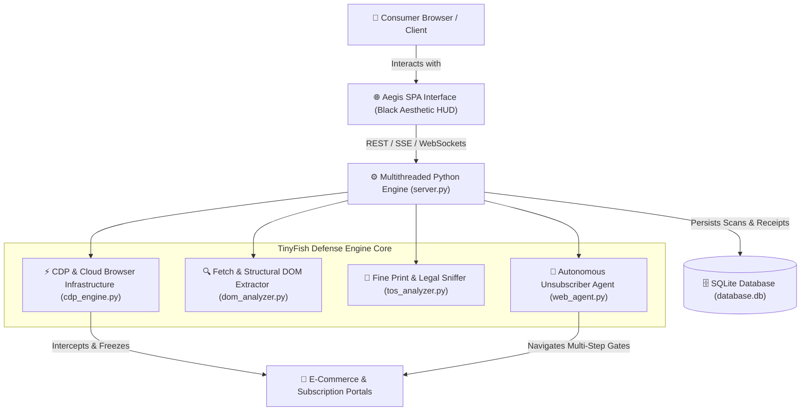

# 🛡️ DarkShield AI // Real-Time Dark Pattern & Scam Defense Engine

> **Autonomous Consumer Guardian powered by TinyFish CDP Browser Infrastructure, Fetch API Structural DOM Analysis, and Ethical AI Web Agents.**

---

## 🎯 The Problem
Modern e-commerce and subscription platforms deploy manipulative UI architectures ("Dark Patterns") to trick consumers:
- **Hidden Recurring Fees & Stealth Renewals**: Free trials converting into unannounced \$39.99/month charges hidden behind 7px fine print.
- **Fake Countdown Timers & Artificial Scarcity**: JavaScript countdown clocks resetting on reload to induce panic purchasing.
- **Pre-Checked Cart Traps ("Sneak into Basket")**: Bundling unwanted \$14.99 warranties and subscriptions without affirmative consent.
- **Confirmshaming Guilt-Trips**: Framing opt-outs in insulting language (*"No thanks, I hate saving money and prefer overpaying"*).
- **Roach Motel Cancellation Mazes**: 1-click subscription signup vs. 7-step impossible attrition portals, mandatory phone queues, and inverted logic checkboxes.

---

## 🚀 How TinyFish Fits

| Core Capability | Implementation in DarkShield AI |
| :--- | :--- |
| **CDP / Browser Infrastructure** | Launches controlled cloud browser sessions via Chrome DevTools Protocol (CDP). Streams real-time DOM mutation events, intercepts network beacons, evaluates timer loops, and injects live defense overlays. |
| **Fetch API & Structural DOM Extraction** | Extracts structural DOM hierarchies, inspects low-contrast CSS evasions (`opacity < 0.2`, `font-size < 8px`), audits Terms of Service (ToS) fine print, and calculates an objective **Deception Index (0–100)**. |
| **Autonomous Web Agent** | An autonomous Playwright/CDP agent that navigates tricky multi-step cancellation portals on command. Bypasses retention diversions, unticks sneaky renewal fees, and executes unsubscriptions with cryptographic proof. |

---

## ✨ Simple, User-Friendly Navigation

1. **🛍️ Store Protection (Live Test Sandbox)**:
   - Interactive e-commerce store with toggleable **DarkShield Defense Shield**.
   - Watch fake countdown timers freeze, hidden \$14.99 warranty fees get unticked, and guilt-trip popups neutralized into fair choices.
2. **🔍 Website & Contract Checker**:
   - One-click scan of shopping carts, free trials, and subscription contracts with a visual **Trust & Scam Score (0–100)** and plain-English breakdown.
3. **🤖 1-Click Auto-Canceller (Web Agent)**:
   - Autonomous unsubscription solver that bypasses multi-step retention screens, cancels subscriptions, and issues official proof of cancellation.
3. **🤖 Autonomous Web Agent Arena**:
   - Watch the AI agent systematically overcome deceptive cancellation flows across streaming, fitness, and SaaS portals.
   - Real-time reasoning trace displaying DOM decision trees, dispatched CDP input events, and obstacle resolutions.
   - Generates official **Proof of Cancellation Certificates** with annual savings calculations.
4. **🧪 Dark Pattern Interactive Test Range**:
   - Realistic mock e-commerce shopping experience (*HyperKicks Global Store*).
   - Toggle **TINYFISH DEFENSE SHIELD** on/off to see fake timers freeze, pre-selected add-ons get unticked, and confirmshaming modals neutralized in real time.
5. **📚 Threat Taxonomy**:
   - 8 Dark Pattern categories categorized under FTC 15 U.S.C. § 45, EU Digital Services Act (DSA), and ROSCA guidelines.
6. **🧩 Chrome Extension Companion (Manifest V3)**:
   - Fully functional Chromium extension ready to load unpacked into Chrome/Brave/Edge.

---

## 🛠️ Architecture & Tech Stack



- **Backend**: Pure Python 3.12 standard library (`http.server.ThreadingHTTPServer`, `sqlite3`, `urllib`, `html.parser`, `re`, `uuid`). Zero external pip dependency risks — runs anywhere instantly.
- **Frontend**: Vanilla JavaScript (ES6+), Web Audio API cyber synthesizer, HTML5 Canvas generative neural visualizer, Glassmorphism dark aesthetic CSS.
- **Browser Extension**: Manifest V3 content scripts, background service worker, and floating guardian HUD.

---

## 🏁 Quick Start Guide

### 1. Launch the Engine Server
Run the provided start script:
```bash
./start.sh
```
Or directly with Python 3:
```bash
python3 server.py 8000
```

### 2. Open the Web Dashboard
Navigate to:
```
http://localhost:8000
```

### 3. (Optional) Load the Chrome Extension
1. Open `chrome://extensions` in Chrome, Brave, or Edge.
2. Enable **Developer mode**.
3. Click **Load unpacked** and select the `/extension` directory.

---

## 🏆 Why It Stands Out for Hackathons
1. **Strong Ethical AI Positioning**: Directly empowers everyday consumers against predatory deceptive design.
2. **Deep Playwright / CDP Utilization**: Moves beyond simple passive ad-blocking by executing active browser manipulation via Chrome DevTools Protocol.
3. **Flawless Zero-Dependency Execution**: Clean, self-contained architecture that launches instantly without build errors or pip dependency conflicts.
4. **Striking Cyberpunk Aesthetic**: Black, abstract, responsive UI with interactive canvas visualizer and synthesized Web Audio feedback.
